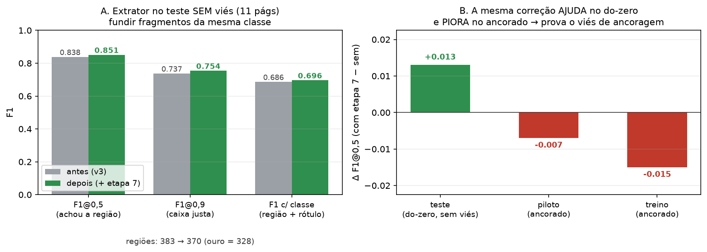

# Extrator mais conciso — etapa 7 (`fundir_fragmentos`)

*16/09/2026 — melhoria da EXTRAÇÃO (caixas) do extrator, usando o ouro do Diamond, medida no teste
sem viés `diamond_teste` (11 páginas desenhadas do zero, sem ancoragem).*

## O problema que o Pedro apontou

O extrator não estava só errando rótulos — estava **quebrando regiões demais** (super-segmentação):
produzia **+17%** de caixas a mais que a anotação humana. Isso piora tanto a localização quanto a
qualidade da caixa (F1@0,9, que exige caixa justa).

## Diagnóstico (o que o ouro humano mostrou)

Alinhando cada região do ouro às do extrator por pertencimento de palavra, no `diamond_teste`:

| Modo de erro | Quantidade | Balde principal |
|---|---:|---|
| **Super-split** (1 região de ouro → ≥2 caixas do extrator) | 26 regiões | `outro→outro` ×8 (marcas de diagramação), sobra de bloco em `texto` |
| **Super-merge** (1 caixa do extrator → ≥2 regiões de ouro) | 12 regiões | fusão de listas |

**Armadilha descoberta:** o ouro mantém **de propósito** 75 pares de `texto` vizinhos com vão mínimo
(campos curtos empilhados). Ou seja, **não dá para juntar `texto` só por estarem perto** — isso destrói
essas separações legítimas (num teste, F1@0,5 despencou de 0,838 para 0,73). Só é seguro fundir onde o
ouro **nunca** separa: marcas/rodapé/cabeçalho, e `texto` **apenas** quando um dos lados veio da sobra de
bloco (`origem="regras"`), com vão mínimo.

## A correção (etapa 7)

Um passo final no extrator (`src/data/regioes.py`, `_fundir_fragmentos`) que junta caixas **da mesma
classe**, mesma coluna e verticalmente contíguas, **só** nos casos seguros acima. Ligado por padrão
(`propor(..., fundir=True)`); desligável para ablação.

## Resultado (teste SEM viés, 11 páginas)

| Métrica | Antes (v3) | Depois (+ etapa 7) |
|---|---:|---:|
| F1@0,5 (achou a região) | 0,838 | **0,851** |
| F1@0,9 (caixa justa) | 0,737 | **0,754** |
| F1 c/ classe | 0,686 | **0,696** |
| nº de regiões | 383 | **370** (ouro = 328) |

Reproduzível: `venv/Scripts/python.exe src/eval/avaliar_diamond.py --lote diamond_teste` compara
`regioes` (com etapa 7) e `regioes_sem_fundir`.

## O achado metodológico (o mais forte para a banca)

A **mesma** correção **ajuda** no teste do-zero (+0,013) e **piora** nos lotes ancorados (piloto −0,007,
treino −0,015). Motivo: o ouro daqueles lotes foi corrigido **a partir da** proposta do próprio extrator,
então a super-segmentação está **embutida** naquele gabarito. É uma prova quantitativa de que medir contra
dado ancorado engana — e de por que o conjunto de teste desenhado do zero é indispensável.

## Honestidade e próximos passos

- O ganho é **real e seguro** (nunca piora no teste sem viés), mas **modesto**: 11 páginas é um *n* pequeno,
  e o extrator já era forte. A confiança estatística pede mais páginas anotadas do zero.
- Fica **fora** desta correção o super-split `texto→texto` de duas caixas do próprio detector (não é seguro
  juntar geometricamente) e os splits que misturam classe (`assinatura`→`título`+`texto`), que vêm das regras.
- **Ainda disponível, sem virar híbrido:** um reclassificador leve por features, treinado nas 96 páginas de
  ouro, leva o acerto de classe de **77% → 81%** (F1 c/ classe 0,686 → 0,714). Pronto para integrar quando o Pedro quiser.
