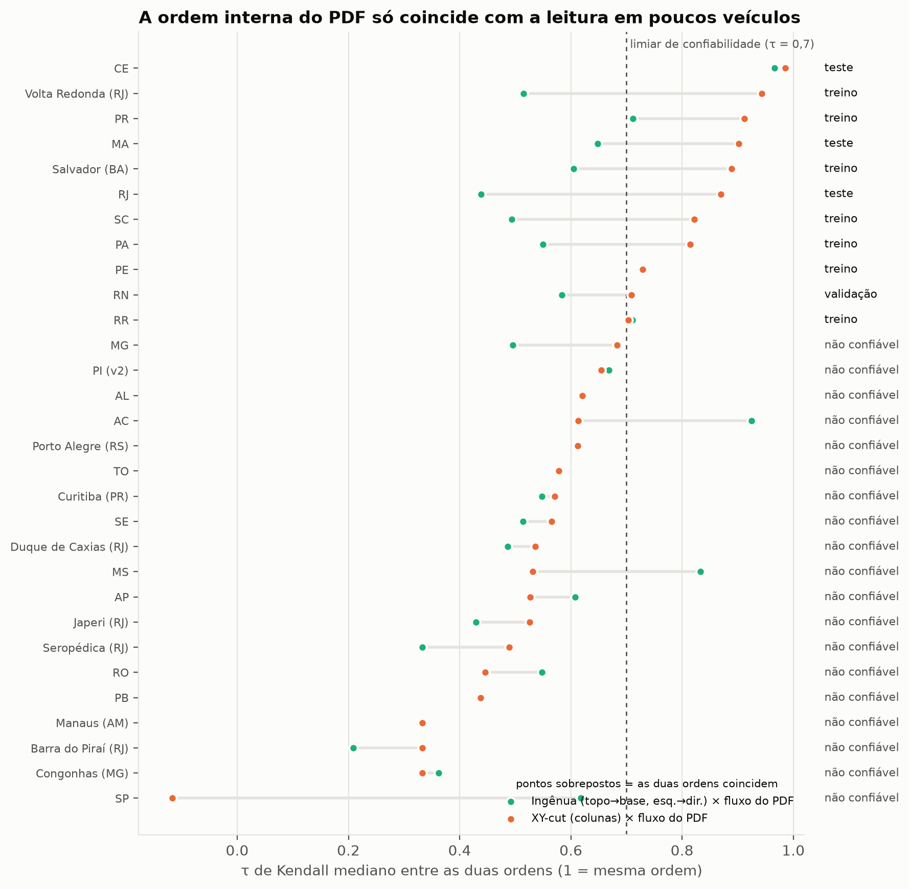
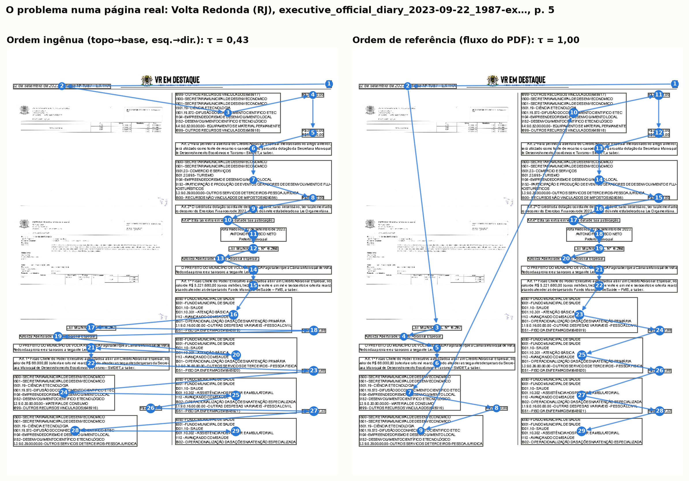
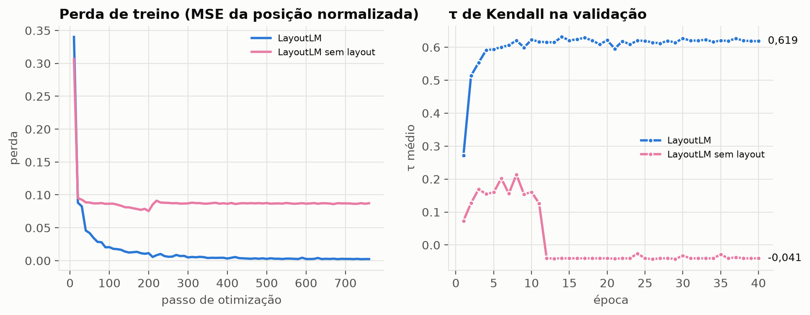
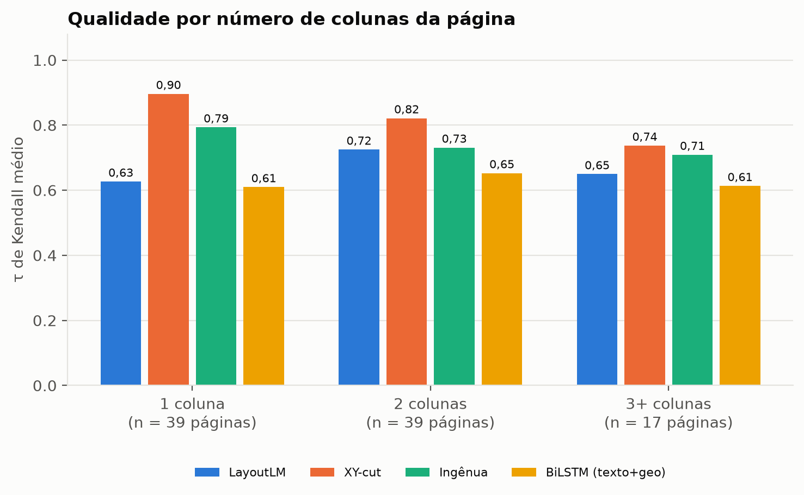
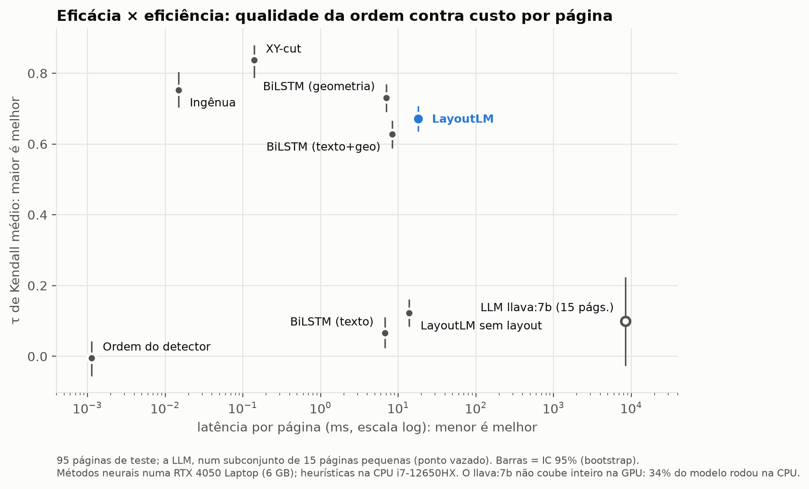
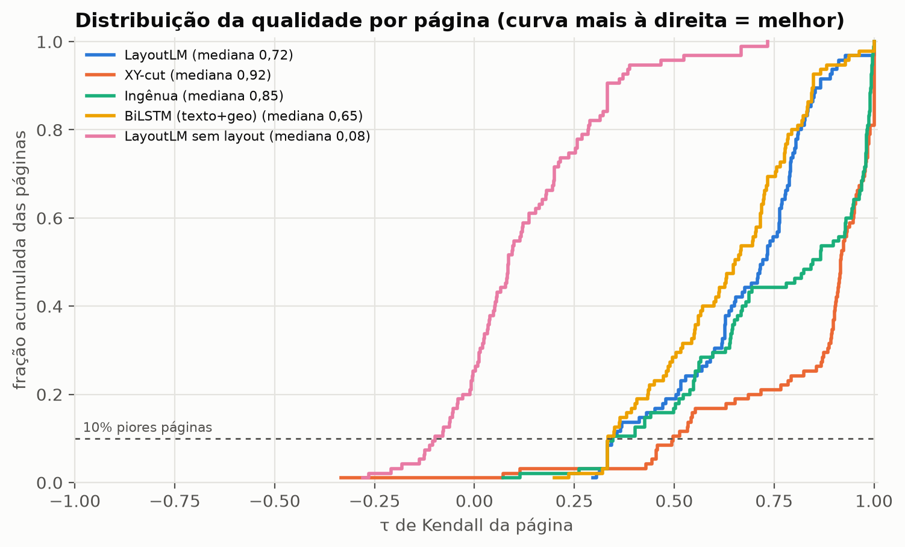
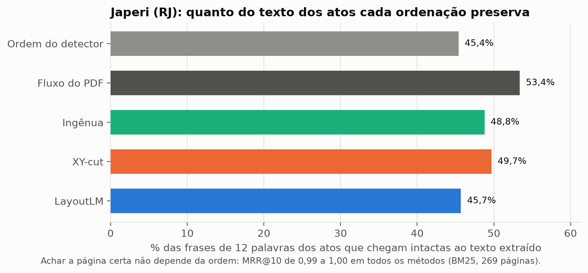
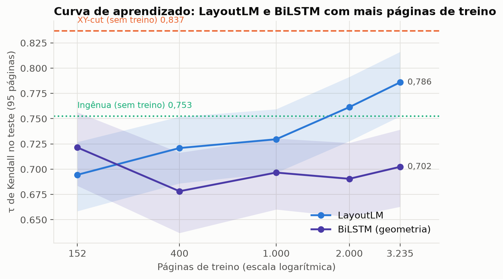

# Resultados Preliminares

Primeira bateria completa de experimentos, executada em **2026-09-10** numa
RTX 4050 Laptop (6 GB) e CPU i7-12650HX. O desenho experimental está em
[METODOLOGIA.md](METODOLOGIA.md); os números brutos, em `resultados/`
(`comparacao.json`, `comparacao.md`, `caracterizacao.json` e os logs de cada etapa).

> ⚠️ **Como ler estes resultados.** A referência é um rótulo *silver* (a ordem do
> fluxo do PDF nos veículos em que ela é confiável), o treino tem só 152 páginas de
> 7 veículos, e cada experimento foi rodado uma vez, com uma semente. São resultados
> **preliminares**: servem para validar o pipeline, dimensionar o problema e orientar
> as próximas decisões — não para as conclusões finais do TCC, que dependem do
> Golden Dataset anotado manualmente.

---

## 1. Caracterização: a ordem interna do PDF não é confiável

Amostra de **777 páginas de 30 veículos** (23 UFs e 7 municípios; o PI foi excluído
por ter 86% do texto ilegível). **50% das páginas são multicoluna.**

Para cada página foram comparadas três ordens (τ de Kendall mediano):

| Par de ordens | τ mediano |
|---|---:|
| Ingênua (topo→base, esq.→dir.) × fluxo do PDF | 0,556 |
| XY-cut (heurística de colunas) × fluxo do PDF | 0,618 |
| Ingênua × XY-cut | 0,923 |

**O fluxo de conteúdo do PDF só se comporta como ordem de leitura em 11 dos 30
veículos** (τ mediano com a XY-cut ≥ 0,7). Com o limiar mais exigente de 0,9, sobram
apenas 4 (CE, Volta Redonda, PR e MA).

O caso mais revelador são os veículos de **coluna única**, onde ler é trivialmente de
cima para baixo — a ordem ingênua e a XY-cut coincidem (τ = 1,00) — e ainda assim o
fluxo do PDF discorda: Manaus (τ = 0,33), Congonhas (0,33), Tocantins (0,58),
Curitiba (0,57), Porto Alegre (0,61). Nesses veículos, o software de publicação grava
o texto numa ordem que não é a de leitura.

**Implicação para o TCC:** ter o PDF digital *não* resolve o problema. A ordem
interna do arquivo não é confiável na maioria dos veículos, então um método de ordem
de leitura baseado em layout é necessário mesmo sem OCR. Isso reforça a motivação do
trabalho — e mostra por que o Golden Dataset manual é indispensável: o rótulo silver
só existe para um terço dos veículos.

**Caso a auditar:** em SP, a XY-cut e o fluxo do PDF estão *anticorrelacionados*
(τ = −0,12), com 92% das páginas multicoluna. Ou a heurística falha no layout de SP,
ou o fluxo está invertido — precisa de inspeção visual.

---

## 2. Configuração

| Partição | Veículos | Páginas |
|---|---|---:|
| Treino | Volta Redonda (RJ), Salvador (BA), PA, PE, PR, RR, SC | 152 |
| Validação | RN | 15 |
| Teste | CE, MA, RJ | 95 |

Referência: ordem do fluxo do PDF, nos veículos com τ mediano ≥ 0,7 contra a XY-cut.
Os veículos de teste nunca aparecem no treino. O LayoutLM e sua ablação foram
treinados com o mesmo orçamento: 40 épocas (seção 4.3).

---

## 3. Comparação principal — 95 páginas de teste

| Método | τ Kendall (IC 95%) ↑ | τ pior caso (p10) ↑ | Sucessor correto ↑ | ARD ↓ | ARD norm. ↓ | BLEU ↑ | Acerto exato ↑ | Latência (ms/pág.) ↓ |
|---|---:|---:|---:|---:|---:|---:|---:|---:|
| Ordem do detector (sem ordenar) | −0,005 (−0,056 a 0,043) | −0,200 | 4,8% | 16,29 | 0,330 | 94,2 | 1,1% | 0,001 |
| Ingênua (topo→base, esq.→dir.) | 0,753 (0,704 a 0,804) | 0,347 | 52,5% | 5,84 | 0,106 | 96,9 | 1,1% | 0,015 |
| **XY-cut (heurística de colunas)** | **0,837** (0,788 a 0,880) | **0,496** | **64,2%** | **3,46** | **0,067** | 96,8 | **18,9%** | 0,141 |
| BiLSTM: só texto | 0,066 (0,024 a 0,111) | −0,195 | 5,5% | 16,21 | 0,309 | 94,2 | 1,1% | 6,8 |
| BiLSTM: só geometria | 0,731 (0,691 a 0,769) | 0,459 | 27,1% | 5,85 | 0,105 | 94,7 | 7,4% | 7,1 |
| BiLSTM: texto + geometria | 0,628 (0,588 a 0,666) | 0,334 | 15,5% | 7,09 | 0,136 | 94,3 | 2,1% | 8,3 |
| LayoutLM sem layout (ablação) | 0,122 (0,084 a 0,160) | −0,099 | 5,5% | 15,64 | 0,294 | 94,1 | 0,0% | 13,8 |
| LayoutLM: texto + layout 2D | 0,671 (0,636 a 0,707) | 0,345 | 13,4% | 6,25 | 0,123 | 94,6 | 3,2% | 18,0 |

*Sucessor correto:* fração dos blocos que, na ordem predita, são seguidos pelo mesmo
bloco que os segue na referência. Métrica acrescentada na segunda sessão (seção 4.8).

### Subconjunto com a LLM — 15 páginas com até 25 blocos

Todos os métodos nas mesmas 15 páginas. Por serem páginas pequenas, a ordem entre os
métodos muda: aqui a ingênua supera a XY-cut.

| Método | τ Kendall (IC 95%) ↑ | τ p10 ↑ | ARD norm. ↓ | Latência (ms/pág.) ↓ |
|---|---:|---:|---:|---:|
| Ingênua | **0,817** (0,724 a 0,905) | 0,562 | 0,073 | 0,006 |
| BiLSTM: só geometria | 0,732 (0,630 a 0,827) | 0,419 | 0,104 | 2,6 |
| XY-cut | 0,680 (0,492 a 0,843) | 0,429 | 0,126 | 0,043 |
| LayoutLM | 0,658 (0,549 a 0,768) | 0,333 | 0,131 | 17,6 |
| LayoutLM sem layout | 0,233 (0,120 a 0,344) | −0,099 | 0,261 | 12,5 |
| **LLM llava:7b (zero-shot)** | **0,099** (−0,027 a 0,224) | −0,333 | 0,306 | **8.414,7** |
| Ordem do detector | 0,040 (−0,173 a 0,257) | −0,410 | 0,309 | 0,001 |

---

## 4. O que os números dizem

### 4.1 A heurística XY-cut é o método a bater
Com τ = 0,837, o melhor pior caso (0,496) e 18,9% das páginas perfeitamente
ordenadas, a heurística de colunas vence todos os métodos aprendidos nesta rodada —
em 0,14 ms por página. O resultado é coerente com a literatura: em layouts regulares,
regras geométricas são fortes. **O espaço para modelos aprendidos está nas páginas em
que a heurística falha** — e a seção 4.6 mostra onde elas estão.

Uma ressalva que favorece a XY-cut: os veículos de teste foram escolhidos entre os que
têm fluxo confiável, e a confiabilidade foi medida pela concordância *com a própria
XY-cut*. O Golden Dataset elimina esse viés.

### 4.2 Layout é indispensável
| | Sem geometria | Com geometria |
|---|---:|---:|
| BiLSTM | 0,066 (só texto) | 0,731 (só geometria) |
| LayoutLM (40 épocas nos dois casos) | 0,122 (caixas zeradas) | 0,671 |

Com os blocos embaralhados, **o texto sozinho quase não recupera a ordem de leitura**.
Sem as caixas, o LayoutLM ainda pesca pistas textuais — cabeçalhos tendem a vir
primeiro, assinaturas e rodapés por último —, o que explica o τ de 0,122 em vez de
zero; mas perde 0,55 de τ. Esta é a evidência mais limpa desta rodada a favor da
premissa do trabalho: **a informação que resolve a tarefa está na geometria 2D**.

### 4.3 Com pouco dado, geometria explícita vence texto
O BiLSTM **só com geometria** (0,731) superou o BiLSTM **com texto e geometria**
(0,628) e o LayoutLM (0,671). Com 152 páginas de treino, o texto codificado por
*hashing* (16 milhões de parâmetros de *embedding*) mais atrapalha do que ajuda — o
modelo sobreajusta.

O treino do LayoutLM foi feito em duas rodadas:

| Rodada | Épocas | Tempo | Melhor τ na validação | τ no teste |
|---|---:|---:|---:|---:|
| 1 | 8 | 56 s | 0,606 (ainda subindo) | 0,660 |
| 2 | 40 | 247 s | 0,631 (estável desde a época 10) | 0,671 |

Quintuplicar o treino rendeu só +0,011 de τ no teste: **o gargalo é o volume de dados
rotulados, não o tempo de treino.** A seção 7 testa isso diretamente, com 21 vezes mais
páginas.

### 4.4 A LLM zero-shot falha — e o modo de falha é revelador
O `llava:7b` obteve τ = **0,099**, estatisticamente indistinguível do acaso no
subconjunto de 15 páginas. Mas o dado mais interessante é *como* ele erra:

| τ da ordem devolvida pela LLM contra… | média | mediana |
|---|---:|---:|
| …a ordem em que os blocos **chegaram** | 0,661 | **0,905** |
| …a ordem **correta** | 0,099 | 0,121 |

**A LLM ecoa a ordem de entrada.** Em 11 das 15 páginas, a resposta ficou mais perto da
ordem em que os blocos foram apresentados do que da ordem correta. Em vez de raciocinar
sobre as coordenadas, o modelo tende a devolver os rótulos na sequência em que os leu
(B1, B2, B4, B5, …).

**Confiabilidade de formato:** 12 de 15 respostas (80%) eram permutações válidas. As
falhas foram de três tipos — bloco repetido (21 rótulos com 20 distintos), geração
além do necessário (29 rótulos para 18 blocos) e omissão (17 de 21 blocos).

**Custo:** 8,4 s por página em média (1,8 a 17,6 s), ~1.155 tokens de entrada e ~77 de
saída, 11,9 tokens/s. No mesmo subconjunto, é **~480 vezes** a latência do LayoutLM e
**~200 mil vezes** a da XY-cut.

Ressalvas importantes: o `llava:7b` é um modelo **multimodal**, não um modelo de texto
especializado; com contexto de 8.192 tokens ele **não coube inteiro nos 6 GB da GPU**
(34% das camadas rodaram na CPU, o que infla a latência); e 15 páginas é uma amostra
pequena. O próximo passo, já preparado, é repetir com modelos de texto de 7B a 32B
(Qwen 2.5), com e sem exemplos no prompt, numa GPU do Kaggle ([KAGGLE.md](KAGGLE.md)).

### 4.5 O BLEU não discrimina nesta granularidade
A ordem **aleatória** marca BLEU **94,2**; a XY-cut, 96,8. Em nível de bloco, quase
todos os n-gramas são internos aos blocos e sobrevivem a qualquer reordenação (numa
página totalmente invertida, o BLEU ainda dá 82,7). **As conclusões devem se apoiar no
τ de Kendall, no ARD e no sucessor correto**; o BLEU fica como métrica de continuidade
com a literatura.

### 4.6 A vantagem da heurística encolhe com o número de colunas

| Método | 1 coluna (39 págs.) | 2 colunas (39) | 3+ colunas (17) |
|---|---:|---:|---:|
| XY-cut | 0,896 | 0,821 | 0,737 |
| Ingênua | 0,793 | 0,731 | 0,709 |
| BiLSTM: só geometria | 0,713 | 0,758 | 0,709 |
| LayoutLM | 0,627 | 0,725 | 0,649 |
| *Vantagem da XY-cut sobre o LayoutLM* | *0,269* | *0,096* | *0,088* |

A XY-cut perde 0,16 de τ entre páginas de 1 e de 3+ colunas; os modelos aprendidos
são mais estáveis entre os grupos. A vantagem da heurística sobre o LayoutLM cai de
0,27 nas páginas de coluna única para 0,09 nas de três ou mais colunas. **É nos
layouts difíceis que o modelo aprendido chega mais perto** — onde há mais a ganhar.

### 4.7 Eficiência
| Método | Latência por página | Onde roda |
|---|---:|---|
| Ingênua | 0,015 ms | CPU |
| XY-cut | 0,14 ms | CPU |
| BiLSTM | 7–8 ms | CPU |
| LayoutLM | 18 ms | GPU (~3 GB de VRAM no treino) |
| LLM llava:7b | 8.400 ms | GPU + CPU (não cabe em 6 GB) |

Para o acervo inteiro (~310 mil páginas), só a etapa de ordenação custaria menos de
1 minuto com a XY-cut, cerca de 1,5 hora com o LayoutLM e cerca de 30 dias com o
llava:7b (medido em páginas pequenas; o custo real seria maior). A extração do PDF,
comum a todos, fica de fora da conta.

### 4.8 O τ esconde o texto picotado

O τ de Kendall mede a ordem **global**: quantos pares de blocos estão na ordem certa.
Para quem vai ler, buscar trechos ou alimentar uma LLM, importa outra coisa: se **o
bloco certo vem logo em seguida**. Trocar dois vizinhos custa um único par discordante
no τ, mas desfaz até três emendas do texto. Por isso foi acrescentada a métrica
**sucessor correto** (`acerto_sucessor` em `src/eval/metrics.py`).

| Método | τ | Sucessor correto |
|---|---:|---:|
| XY-cut | 0,837 | **64,2%** |
| Ingênua | 0,753 | 52,5% |
| BiLSTM: só geometria | 0,731 | 27,1% |
| LayoutLM | 0,671 | **13,4%** |
| BiLSTM: texto + geometria | 0,628 | 15,5% |
| LLM llava:7b (15 págs.) | 0,099 | 8,5% |
| Ordem do detector | −0,005 | 4,8% |

Os modelos aprendidos acertam a posição aproximada de cada bloco, mas **trocam vizinhos
o tempo todo**. A BiLSTM de geometria tem τ quase igual ao da ingênua (0,731 × 0,753) e
metade da continuidade (27% × 53%). O LayoutLM emenda o bloco certo em 13% das vezes,
2,8 vezes o acaso, contra 64% da XY-cut.

A causa provável é a **formulação**, não o hardware: com uma nota por bloco (regressão
pontual da posição), dois blocos vizinhos na mesma coluna recebem notas muito próximas,
e qualquer ruído os troca. Formulações que preveem **o sucessor de cada bloco** — pares
de blocos, ou um decodificador com ponteiro, como o LayoutReader — atacam exatamente esse
ponto. A seção 6 mostra que é esse tipo de erro que estraga o texto entregue a um RAG.

---

## 5. Significância estatística

Testes de Wilcoxon pareados sobre o τ por página:

| Comparação | Páginas | τ médio | p-valor |
|---|---:|---|---:|
| LayoutLM × ordem do detector | 95 | 0,671 × −0,005 | 8,4·10⁻¹⁷ |
| LayoutLM × ingênua | 95 | 0,671 × 0,753 | 0,013 |
| LayoutLM × XY-cut | 95 | 0,671 × 0,837 | 2,6·10⁻¹¹ |
| LayoutLM × BiLSTM só texto | 95 | 0,671 × 0,066 | 2,6·10⁻¹⁶ |
| LayoutLM × BiLSTM só geometria | 95 | 0,671 × 0,731 | 8,2·10⁻⁹ |
| LayoutLM × BiLSTM texto + geometria | 95 | 0,671 × 0,628 | 4,6·10⁻⁵ |
| LayoutLM × LayoutLM sem layout | 95 | 0,671 × 0,122 | 2,6·10⁻¹⁶ |
| LayoutLM × LLM | 15 | 0,658 × 0,099 | 6,1·10⁻⁵ |
| XY-cut × LLM | 15 | 0,680 × 0,099 | 0,0012 |

Todas as diferenças são significativas ao nível de 5%.

---

## 6. Piloto de RI: a ordem de leitura muda a busca?

Primeira **avaliação extrínseca**, com a pergunta que uma banca de RI faria: e isso muda
o que o sistema de busca devolve? (`src/ri/piloto_japeri.py`)

**Desenho.** Japeri (RJ) é um dos veículos em que o fluxo do PDF *não* concorda com a
XY-cut, e o acervo traz 421 atos dele com o texto em ordem correta de leitura
(`json_atos_japeri`). Foram extraídas todas as 269 páginas das 27 edições; 335 atos têm a
edição no acervo. De cada ato saem até três consultas — uma **frase** de 12 palavras do
corpo, o **título** (1ª linha) e os 8 **termos** mais raros —, 915 no total. É relevante a
página que contém o conteúdo da consulta, decidido por sobreposição de palavras, que
independe da ordem: a relevância é a mesma para todos os métodos, e só muda o texto que
cada ordenação produz.

| Método | Frases preservadas | Diferença para o piso | Contexto para RAG | MRR@10 (frase, por trechos) |
|---|---:|---:|---:|---:|
| Ordem do detector (piso) | 45,4% | — | 44,8% | 0,988 |
| **Fluxo do PDF** | **53,4%** | **+8,0 p.p.** | **52,8%** | 0,998 |
| Ingênua | 48,8% | +3,4 p.p. | 48,5% | 0,997 |
| XY-cut | 49,7% | +4,3 p.p. | 49,4% | 0,998 |
| LayoutLM | 45,7% | +0,3 p.p. | 44,8% | 0,997 |

*Frases preservadas:* frases de 12 palavras dos atos que chegam ao texto da página com
ao menos 10 palavras alinhadas. *Contexto para RAG:* consultas-frase cujo primeiro trecho
devolvido contém a frase preservada — o que um RAG entregaria à LLM. *Busca por trechos:*
BM25 em janelas de 100 palavras (passo 50); a página vale o seu melhor trecho.

**O que o piloto mostra**

1. **Achar a página certa não depende da ordem**, nem com a página inteira como documento
   (MRR@10 de 0,987 a 0,995, idêntico para todos, porque o saco de palavras é o mesmo) nem
   com busca por trechos (0,988 a 0,998). Com uma coleção pequena e consultas específicas,
   a busca satura. É um resultado negativo útil: o argumento "texto embaralhado estraga a
   busca" não vale para a busca de páginas.
2. **O texto entregue ao leitor ou à LLM depende da ordem.** Entre a pior e a melhor
   ordenação, 8 pontos percentuais das frases dos atos deixam de chegar intactas. É aí que
   a ordem de leitura pesa em RI: no contexto de um RAG, em trechos e em citações.
3. **Em Japeri, o fluxo do PDF preserva mais texto que a XY-cut.** Japeri está entre os
   veículos "não confiáveis" porque o fluxo discorda da XY-cut, mas aqui quem parece errar
   mais é a heurística. Discordar da XY-cut não prova que o fluxo esteja errado; só a
   anotação humana decide (grupo `incerto` do Golden).
4. **O LayoutLM fica no nível do piso**, coerente com os 13% de sucessor correto da seção
   4.8: seus erros são justamente os que picotam frases.

**Ressalvas.** Um veículo só; a origem do texto dos atos precisa ser confirmada (pode ser
saída do Azure, e não anotação manual); o valor absoluto das frases preservadas é baixo
(54,6% chegam intactas em pelo menos um método), porque o texto dos atos e a camada de
texto do PDF nem sempre coincidem — é a comparação entre métodos que conta. Próximos
passos: coleção maior, consultas em linguagem natural, busca densa e um RAG completo
medindo a qualidade das respostas.

---

## 7. Curva de aprendizado: mais dados fecham a distância?

Para testar se a derrota do LayoutLM é falta de dado, o treino foi ampliado com 3.117
páginas extras dos mesmos 7 veículos (3.235 no total, 21 vezes o treino original), em
subconjuntos aninhados — o de 152 páginas é exatamente o treino original, e cada tamanho
maior contém o anterior. Validação e teste ficaram intocados, e cada tamanho recebeu o
número de épocas necessário para cerca de 6.000 passagens de página.

| Páginas de treino | τ no teste (IC 95%) | τ nas 10% piores | Sucessor correto | Épocas | Tempo de treino |
|---:|---:|---:|---:|---:|---:|
| 152 | 0,694 (0,658 a 0,727) | 0,387 | 15,6% | 40 | 287 s |
| 400 | 0,721 (0,686 a 0,752) | 0,442 | 16,8% | 15 | 305 s |
| 1.000 | 0,730 (0,696 a 0,759) | 0,455 | 15,1% | 6 | 279 s |
| 2.000 | 0,761 (0,728 a 0,791) | 0,494 | 19,1% | 4 | 362 s |
| **3.235** | **0,786** (0,752 a 0,816) | **0,527** | **20,8%** | 4 | 601 s |

A BiLSTM de geometria, na mesma curva, não se mexe: 0,721 com 152 páginas e 0,702 com
3.235 (entre 0,678 e 0,697 nos tamanhos intermediários). Ela satura com pouquíssimo dado,
o que faz sentido para um modelo que vê 8 números por bloco.

**O que a curva diz**

1. **O LayoutLM era limitado por dados — e ainda é.** O τ sobe cerca de 0,03 cada vez que o
   treino dobra, sem sinal de estabilizar até 3.235 páginas. A conclusão da seção 4.3, de
   que o gargalo eram as 152 páginas, se confirma.
2. **O pior caso já é melhor que o da heurística.** Nas 10% piores páginas, o LayoutLM com
   3.235 páginas marca 0,527 contra 0,496 da XY-cut. Na média ainda perde (0,786 × 0,837),
   mas a diferença caiu de 0,14 para 0,05.
3. **A continuidade quase não melhorou:** o sucessor correto foi de 15,6% para 20,8%, longe
   dos 64,2% da XY-cut. Mais dados corrigem a ordem global; a troca de vizinhos vem da
   formulação pontual e continua lá.
4. **Custo:** o maior treino levou 10 minutos na RTX 4050. Escalar os dados não exige GPU
   nova — o gargalo é a extração dos PDFs, e o PyMuPDF é a otimização planejada.

**Consequência para o TCC:** as duas frentes se justificam. (a) Escalar o treino para
dezenas de milhares de páginas, o que a tendência sugere aproximar o LayoutLM da XY-cut em
τ; (b) trocar a formulação para prever o sucessor de cada bloco, que é o que a continuidade
exige. O checkpoint de 3.235 páginas ficou em
`models/layoutlm_ordem/curva_layoutlm_n3235.pt` e deve ser o modelo avaliado no Golden.

---

## 8. Limitações desta rodada

- **Referência silver** e escolha dos veículos confiáveis pela concordância com a
  XY-cut — viés a favor da heurística. O lote `golden_v1` de anotação humana está
  pronto ([GUIA_ANOTACAO.md](GUIA_ANOTACAO.md)).
- **Pouco dado de treino** no experimento principal: 152 páginas de 7 veículos (a seção 7
  mede o efeito de 21 vezes mais).
- **Uma única execução** por método; sem variação de semente.
- **LLM**: modelo multimodal, 15 páginas, parcialmente na CPU. Modelos de texto de 7B a
  32B estão prontos para rodar no Kaggle.
- **Tokenizador do LayoutLM em inglês**, sem acentos.
- **Granularidade de bloco** depende da heurística de segmentação.
- **Piloto de RI** com um único veículo, uma coleção pequena e só BM25.

## 9. O que isto sugere para o TCC

1. A premissa se sustenta: **o problema existe mesmo em PDFs digitais** (seção 1) e
   **a geometria é o que resolve a tarefa** (seção 4.2).
2. O competidor a bater não é a LLM — que falhou e custa ~480× mais que o LayoutLM —,
   mas a **heurística geométrica**. A pergunta mais interessante passa a ser *em que
   páginas um modelo aprendido supera a heurística*, e a que custo.
3. **Para RI, a métrica que importa é a continuidade do texto** (sucessor correto), e
   nela os modelos aprendidos vão mal por causa da formulação pontual (seção 4.8). Prever
   o sucessor de cada bloco é o caminho mais promissor para o LayoutLM.
4. **A ordem pesa no texto entregue, não em achar a página** (seção 6). O argumento de RI
   do TCC deve se apoiar em trechos, citações e RAG.
5. **Mais dados ajudam, mas não resolvem sozinhos** (seção 7): o τ do LayoutLM sobe de
   0,694 para 0,786 com 21 vezes mais páginas, e o pior caso já supera o da XY-cut — só a
   continuidade não acompanha.
6. Próximas prioridades, detalhadas em [ROADMAP.md](ROADMAP.md): anotar o `golden_v1`,
   rodar as LLMs de texto no Kaggle, escalar a extração e testar o LayoutLM prevendo o
   sucessor de cada bloco.

## Figuras

| Arquivo | Conteúdo |
|---|---|
| `figuras/fig1_caracterizacao_por_veiculo.png` | Concordância entre ordens, por veículo |
| `figuras/fig2_problema_pagina_real.png` | Ordem ingênua × referência numa página real |
| `figuras/fig3_treino_layoutlm.png` | Curvas de treino e validação (LayoutLM e ablação) |
| `figuras/fig4_tradeoff_eficacia_eficiencia.png` | τ × latência — o trade-off do TCC |
| `figuras/fig5_distribuicao_tau_por_pagina.png` | Distribuição do τ por página (pior caso) |
| `figuras/fig6_tau_por_colunas.png` | τ por número de colunas |
| `figuras/fig7_curva_aprendizado.png` | τ no teste × páginas de treino (LayoutLM e BiLSTM) |
| `figuras/fig8_ri_japeri.png` | Frases dos atos de Japeri preservadas por cada ordenação |
