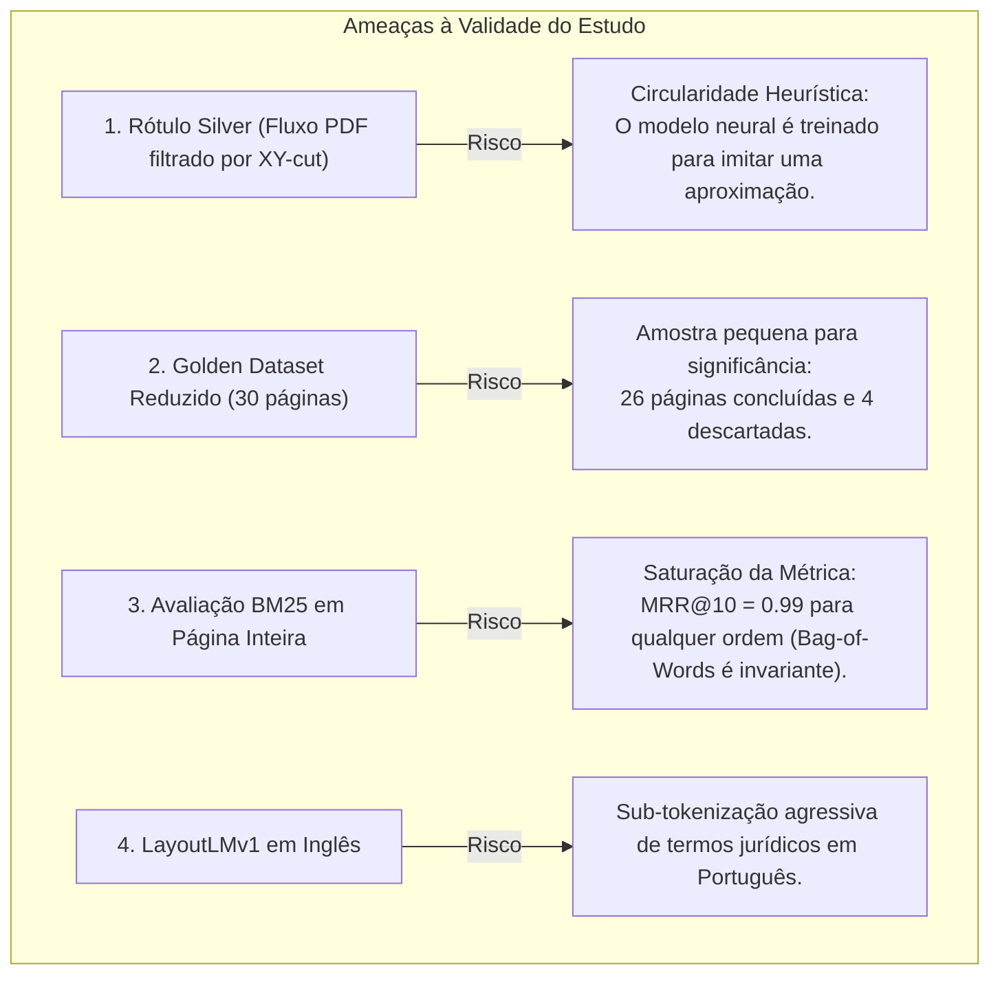
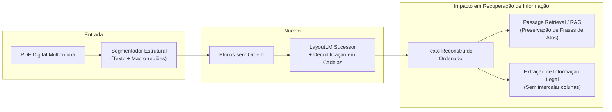

# Revisão Crítica, Diagnóstico e Reposicionamento Estratégico do TCC

**Data da Revisão:** 12 de Setembro de 2026  
**Autor da Análise:** Agente Antigravity (Pair Programming / Pesquisa Experimental)  
**Projeto:** Recuperação de Ordem de Leitura em Diários Oficiais para RI (INF-UFG)  
**Autor do TCC:** Pedro Alano | **Orientador:** Prof. Dr. Thierson Couto Rosa  

---

## Sumário Executivo

Este documento consolida um diagnóstico 360° de tudo o que foi planejado, codificado, medido e anotado no projeto até o momento. O trabalho atingiu maturidade técnica excepcional em várias frentes — notadamente a formulação inovadora de **LayoutLM para predição de sucessor com decodificação em cadeias**, a identificação do **efeito cascata em métricas posicionais**, a demonstração de que o **τ de Kendall esconde texto picotado**, e a criação de uma **ferramenta de anotação cega**.

Contudo, o projeto encontra-se em um ponto de inflexão crítico:
1. **O gargalo da segmentação antecede a ordenação:** caixas sobrepostas geram texto embaralhado internamente que nenhum modelo de ordenação consegue corrigir;
2. **O abismo das tabelas:** revelado categoricamente pelas anotações manuais do Pedro no lote `golden_v1` (12 de 30 páginas com tabelas; 4 puladas unicamente por isso);
3. **A vulnerabilidade metodológica da referência silver:** o modelo corre risco de aprender a apenas imitar a heurística XY-cut;
4. **O elo frágil com Recuperação de Informação (RI):** a busca por documentos/páginas inteiras (BM25) não é afetada pela ordem de leitura ($MRR \approx 0{,}99$), o que exige deslocar a justificativa acadêmica explicitamente para **busca de passagens, fidelidade de extração e RAG (Retrieval-Augmented Generation)**.

---

## 1. Linha do Tempo e Conquistas Consolidadas

| Fase | Período | Principais Entregas | Conquista / Achado |
|---|---|---|---|
| **Fase 1: Setup e Diagnóstico** | 03–09/09 | Inventário do acervo (4.644 PDFs, 19 GB, 23 UFs), ambiente CUDA, PyTorch | Descoberta de que ~96% dos PDFs são digitais (dispensa OCR inicial); descarte de PI por `(cid:N)`. |
| **Fase 2: Baseline e Pipeline** | 10/09 | Pipeline ponta a ponta: `extrator.py`, `metrics.py`, BiLSTM, LayoutLM pontual, XY-cut | Identificação de que o BLEU em blocos é cego (página invertida dá 82,7); adoção do τ de Kendall. |
| **Fase 3: Sucessor e Curva** | 10–12/09 | Formulação de sucessor (`layoutlm_sucessor.py`), decodificação em cadeias, piloto Japeri | O LayoutLM pontual trocava vizinhos (13% sucessor); o modelo de sucessor salta para **51,8%**. |
| **Fase 4: Anotação e Realidade** | 12/09 | Pedro anota o Golden v1 (26 concluídas, 4 puladas); T01–T04 | Descoberta empírica de 6 defeitos de segmentação (calhas globais, tabelas, letras espaçadas, caixas sobrepostas). |

---

## 2. Diagnóstico Crítico: Problemas Presentes e Falhas

### 2.1 O "Calcanhar de Aquiles": Segmentação em Blocos
O projeto assume a tarefa: *dado um conjunto de blocos sem ordem, prever a ordem humana*.
Porém, **os blocos não existem na natureza**: eles são fabricados pelo extrator.
- **Falha de Sobreposição:** Na versão v1, 28,6% dos blocos se sobrepunham. Na versão B, 10,5%. Na versão C, 4,9%, mas com fragmentação excessiva no RJ (159 blocos). Na versão B+, 5,9%.
- **Impacto fatal:** Se uma linha de texto é fatiada no meio e as metades vão para blocos distintos, o texto dentro do bloco já está destruído (*"Art. 1º rios, no âmbito..."*). Nenhuma ordenação posterior, por melhor que seja o modelo (LayoutLM ou GPT-4), recupera a integridade do texto.

### 2.2 O Fenômeno das Tabelas
As anotações do Pedro no `golden_v1` forneceram um dado contundente que não constava na modelagem inicial:
- **12 das 30 páginas contêm tabelas complexas.**
- **Todas as 4 páginas que o Pedro foi forçado a pular ou deixar em rascunho eram de tabelas.**
- O extrator textual agrupa linhas horizontalmente ou verticalmente em calhas; dentro de uma tabela sem bordas rígidas, as células viram dezenas de caixinhas soltas empilhadas ou misturadas entre linhas vizinhas. Tentar ordenar células de tabela como se fossem parágrafos de leitura contínua é um erro de modelagem.

### 2.3 Calhas Globais vs. Calhas Locais
O algoritmo `_calhas()` do `extrator.py` projeta histogramas de ocupação horizontal ao longo da página inteira:
- Se houver um rodapé largo, uma tabela embaixo de duas colunas, ou um carimbo de página inteira, a calha global desaparece.
- Consequência: as linhas de texto acima ou abaixo atravessam de uma coluna para outra. Isso causou os maiores erros apontados pelo Pedro no RJ, em Barra do Piraí e em São Paulo.

### 2.4 Ruídos Visuais e Artefatos Tipográficos
1. **Letras Espaçadas (*letter-spacing*):** Palavras como `"R E S O L V E"` ou `"P A R E C E R"` têm espaços entre cada letra. O extrator quebra essas palavras em blocos de 1 caractere ou em fragmentos.
2. **Separadores Visuais:** Linhas de asteriscos (`*** *** ***`), traços (`---`) ou pontos viram blocos de texto independentes.
3. **Logos e Cabeçalhos em Imagem:** Sem OCR, diários como RJ Legislativo e Congonhas perdem o brasão ou título emitido como imagem vetorial/raster.

---

## 3. Vulnerabilidades Metodológicas e Ameaças à Validade

### 3.1 A Circularidade do Rótulo Silver
- A supervisão de treino dos modelos neurais (152 a 3.235 páginas) baseia-se no fluxo do PDF (`stream`) nos veículos onde ele concorda com a heurística XY-cut ($\tau \geq 0{,}7$).
- **Ameaça de banca:** *"Se vocês só treinam nos veículos onde a XY-cut funciona, o modelo neural não está simplesmente aprendendo a geometria da XY-cut em vez da ordem humana?"*
- **Mitigação:** O lote `incerto` do Golden Dataset (20 páginas de veículos onde a XY-cut falha) é a única prova empírica desvinculada dessa circularidade. Esse lote precisa ser protegido e explorado a fundo.

### 3.2 O Vazio na Argumentação de RI (A Falácia do BM25)
- O piloto em Japeri mostrou que:
  - BM25 na página inteira atinge $MRR \approx 0{,}99$ tanto para a ordem aleatória quanto para XY-cut e LayoutLM.
  - Isso ocorre porque o BM25 clássico é um modelo de saco de palavras (*bag of words*): a ordem das palavras no documento não altera a pontuação de relevância.
- **Risco de Defesa:** Uma banca de Recuperação de Informação pode argumentar: *"Se a ordem de leitura não impacta o ranking BM25, qual é a relevância de ordem de leitura para RI?"*
- **Resposta obrigatória:** A relevância de RI não está no ranqueamento de páginas em nível de documento, mas em:
  1. **Passage Retrieval / Segmentação de Passagens:** janelas de busca cortam o texto; se o texto estiver embaralhado, a janela pega metades desconexas.
  2. **Geração Aumentada por Recuperação (RAG):** a LLM que lê a passagem recuperada sofre com incoerência sintática e alucina quando as frases estão truncadas.
  3. **Extração de Entidades e Atos (Information Extraction):** extrair valores, CPFs e objetos de licitação exige leitura linear contínua.

---

## 4. Lacunas Documentais (O que não está documentado)

Durante a auditoria minuciosa do repositório, identificamos discrepâncias entre o que está documentado nos `.md` e o estado factual do código e dos dados:

1. **Aparecimento Súbito de Modelo de Visão Computacional (`Docling Heron`):**
   - Em `docs/HANDOFF.md` e `docs/METODOLOGIA.md`, afirma-se repetidamente que o projeto dispensa visão computacional/YOLO porque os PDFs são digitais.
   - Porém, em `src/data/layout.py` (criado recentemente), foi introduzido o `Docling Heron` (`RT-DETRv2` com backbone de visão treinado em DocLayNet) para detectar tabelas.
   - *Necessidade documental:* Essa mudança conceitual precisa ser formalmente descrita e justificada em `METODOLOGIA.md` como um componente híbrido (detector visual leve para macro-regiões + extrator de texto digital).

2. **Incompatibilidade Histórica de `resultados/`:**
   - Todas as tabelas e gráficos em `resultados/` e `docs/RESULTADOS_PRELIMINARES.md` pertencem à segmentação v1.
   - Nenhuma tabela do handoff foi recalculada ainda sobre a segmentação corrigida.

3. **Natureza dos Dados de APIs Comerciais:**
   - Os documentos citavam "Google Document AI sobre Japeri". Na realidade (descoberto na T10), são 2 páginas do Diário do Estado do RJ e 12 páginas do Azure cobrindo RJ e Japeri.

4. **Âncora Imutável das Palavras do Golden (`palavras_por_bloco.jsonl`):**
   - Foi criado `src/anotacao/congelar_palavras.py` gerando `derivados/palavras_por_bloco.jsonl` (28.663 palavras ordenadas pelo Pedro). Isso garante que o esforço de anotação do Pedro nunca seja perdido, independente de quantas vezes a segmentação mude. Isso precisa de destaque no `GUIA_ANOTACAO.md`.

---

## 5. Ideias Práticas para Resolver os Problemas Atuais

### 5.1 Tratamento Especial para Tabelas: "Macro-Bloco com Flag"
- **Não fatiar tabelas em linhas normais:** Onde o detector (seja Heron ou heurística de linhas de grade do `pdfplumber`) encontrar uma tabela, emitir a tabela inteira como **um único bloco** com metadado `"tipo": "tabela"`.
- Na avaliação de ordem de leitura, o modelo precisa apenas posicionar a tabela no fluxo linear do documento (antes do parágrafo X e depois do parágrafo Y).
- A ordenação interna das células da tabela deve ser delegada a um algoritmo tabular (ex.: linha a linha ou conversão direta para Markdown), e não ao grafo de sucessores de texto corrido.

### 5.2 Calhas Locais e Faixas Resilientes
- Substituir a projeção vertical global de calhas por **calhas locais por faixa**: uma coluna em branco que exista verticalmente em um trecho contíguo de pelo menos 4 a 5 linhas divide aquelas linhas em colunas, mesmo que no topo da página haja um cabeçalho que ocupe 100% da largura.

### 5.3 Normalização de Texto Prévia (Regex Heurístico)
- **Des-espaçamento de títulos:** Um regex simples como `r"\b([A-ZÀ-Ý]\s+){3,}[A-ZÀ-Ý]\b"` detecta `"R E S O L V E"` e compacta para `"RESOLVE"` antes de criar as palavras e linhas.
- **Filtro de Ruído Não-Alfanumérico:** Descartar qualquer bloco cuja contagem de letras e dígitos seja zero (ex.: caixas contendo apenas `"***"`, `"—"`, `"."`).

### 5.4 Modelo Multilíngue para o Texto: `LayoutXLM` ou `ModernBERT`
- O `microsoft/layoutlm-base-uncased` foi treinado em inglês. Em português, palavras como `"Inconstitucionalidade"` ou `"Superintendência"` viram 6 a 8 sub-tokens WordPiece, esgotando rapidamente o limite de 512 tokens da página.
- **Sugestão:** Utilizar `layoutxlm-base` ou pelo menos incluir um experimento de ablação demonstrando o impacto da fragmentação de tokens em português.

---

## 6. Proposta de Reposicionamento Estratégico do TCC

> [!IMPORTANT]
> **A Pergunta do Usuário:** *"Procurar possíveis ideias pra ajudar nos problemas ou pra fortalecer o TCC, ou talvez mudar o objeto do TCC, não sei..."*

### Devemos mudar o objeto do TCC?
**Não mudar radicalmente, mas REPOSICIONAR (Reframe) com precisão.**

Se o TCC for apresentado puramente como *"Detecção de Ordem de Leitura em Diários Oficiais"*, ele corre o risco de parecer um problema estritamente de visão computacional ou processamento de documentos, onde uma heurística como XY-cut já atinge $\tau = 0{,}837$ e vence os modelos neurais mais complexos.

### O Reposicionamento Recomendado
**Novo Enquadramento do Título/Tema:**
> **"Preservação da Ordem de Leitura e Continuidade Textual em Diários Oficiais para Sistemas de Recuperação de Informação e RAG"**

### Por que esse reposicionamento blinda e valoriza o TCC?

1. **Justifica a criação da métrica "Sucessor Correto":**
   Em RI, o que chega ao usuário ou à LLM não é o rank global de postos ($\tau$), mas a **continuidade local** da frase dentro do chunk recuperado. O fato de o LayoutLM com predição de sucessor saltar de 13% para **51,8%** de sucessor correto torna-se o **resultado estrela** do trabalho!
2. **Transforma o defeito da XY-cut em descoberta:**
   A heurística XY-cut parece imbatível em $\tau$ (0,837), mas ela falha sistematicamente quando há aninhamentos complexos, notas marginais ou tabelas. O trabalho demonstra empiricamente as fronteiras onde a heurística quebra.
3. **Resolve a conexão com a área do orientador (Prof. Thierson):**
   Conecta diretamente o trabalho à literatura de *Learning to Rank* e avaliação de sistemas RAG contemporâneos (tópico de altíssimo impacto em 2026).

---

## 7. Roteiro de Ações Imediatas para o Pedro

1. **Aprovar o modelo híbrido de segmentação (v3):**
   - Confirmar a integração do detector de tabelas (`layout.py`) para tratar tabelas como blocos únicos.
   - Manter a regra de rejeição de caixas sobrepostas.
2. **Projetar a anotação do `golden_v1` nos blocos v3:**
   - Rodar `projetar_ordem.py` sobre `palavras_por_bloco.jsonl`.
   - Como o Pedro já anotou 26 páginas palavra a palavra, a projeção automática recuperará ~80% da ordem sem retrabalho! O Pedro só precisará revisar as 4 páginas com tabelas e pequenos conflitos.
3. **Re-extração definitiva dos dados (T05) e Recalcular Splits (T07):**
   - Re-extrair `blocos`, `blocos_extra` e `blocos_ri_japeri`.
4. **Executar experimentos finais no Kaggle (T12):**
   - Treinar a curva de sucessor nas 3.235 páginas na GPU T4.
   - Rodar Qwen 2.5 nas páginas de teste e no Golden.
5. **Redação orientada ao novo enquadramento:**
   - Capítulo de Introdução focado no gargalo que layouts complexos impõem a pipelines modernos de IA/RAG no setor público.
